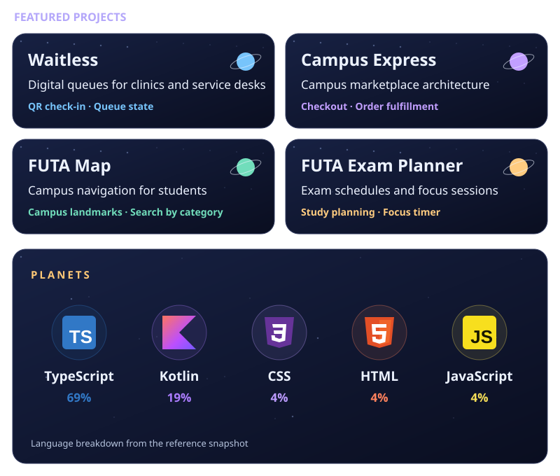

  

<h1 align="center">Adeleke Samuel Adewale</h1>

<strong>Software Engineering · System Design · Software Architecture</strong>

  <a href="https://dewalesamue.vercel.app/projects">Portfolio</a> ·
  <a href="https://www.linkedin.com/in/dewale-samue-b8915b395/">LinkedIn</a> ·
  <a href="https://x.com/dewalesamue">X</a>

## About me

I’m an Information Technology student at the Federal University of Technology, Akure (FUTA). I build web products and design the workflows, APIs, and data models behind them. I’m especially interested in systems that coordinate people in real time, from clinic queues to campus deliveries.

  

<a href="https://futamap.netlify.app/">Open FUTA Map</a> · <a href="https://futaexamplanner.netlify.app/">Open FUTA Exam Planner</a>

Project details and tools

## Featured work

| Project | What I built or designed | System design focus |
| :--- | :--- | :--- |
| **Waitless** | A digital queue concept for clinics and service desks, with QR check-in, virtual tickets, and a provider dashboard. | Queue state and the flow from check-in to being served. |
| **Campus Express** | A campus marketplace designed around buyers, vendors, and riders. | Role-based access, single-vendor instant checkout, and multi-vendor order fulfillment. |
| **[FUTA Map](https://futamap.netlify.app/)** | A campus navigation app for finding lecture theatres, hostels, and other landmarks. | Organizing places by category so students can find them quickly. |
| **[FUTA Exam Planner](https://futaexamplanner.netlify.app/)** | An exam planning app with a focus timer for study sessions. | Connecting exam schedules with day-to-day study planning. |

## Tools I work with

| Area | Stack |
| :--- | :--- |
| Frontend | TypeScript, React |
| Mobile | React Native, Expo |
| Backend and data | Node.js, Express, PostgreSQL, Supabase |
| Deployment | Vercel, Railway, Netlify |

## Orbit log

[View my GitHub contribution history](https://github.com/Dewalesamue#contribution-activity)

---

<strong>Prime λ</strong> · Akure, Nigeria 
<a href="https://dewalesamue.vercel.app/projects">Explore my projects</a> · <a href="https://www.linkedin.com/in/dewale-samue-b8915b395/">Connect on LinkedIn</a>

