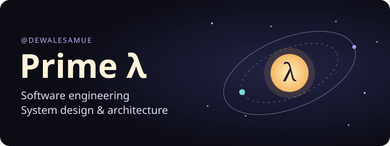

## Hi, I’m Adewale

I’m an Information Technology student at the Federal University of Technology, Akure. I build web products and focus on system design, from mapping user workflows to designing the APIs and data models that support them.

## Selected projects

| Project | What I built or designed |
| --- | --- |
| [FUTA Map](https://futamap.netlify.app/) | A campus navigation app that helps students find lecture theatres, hostels, and other landmarks. |
| [FUTA Exam Planner](https://futaexamplanner.netlify.app/) | An exam planning app with a focus timer for study sessions. |
| Waitless | A digital queue system designed around QR check-in, virtual tickets, and a dashboard for service providers. |

## Tools I work with

TypeScript · React · Node.js · PostgreSQL · Supabase

[Portfolio](https://dewalesamue.vercel.app/projects) · [LinkedIn](https://www.linkedin.com/in/dewale-samue-b8915b395/) · [X](https://x.com/dewalesamue)
